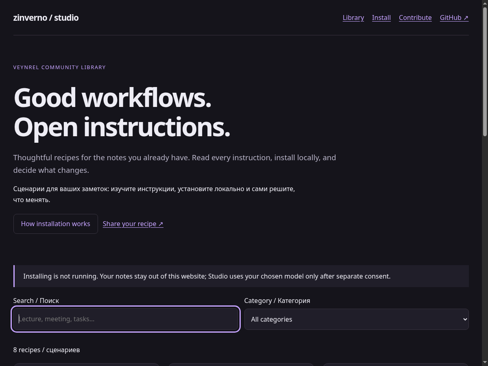
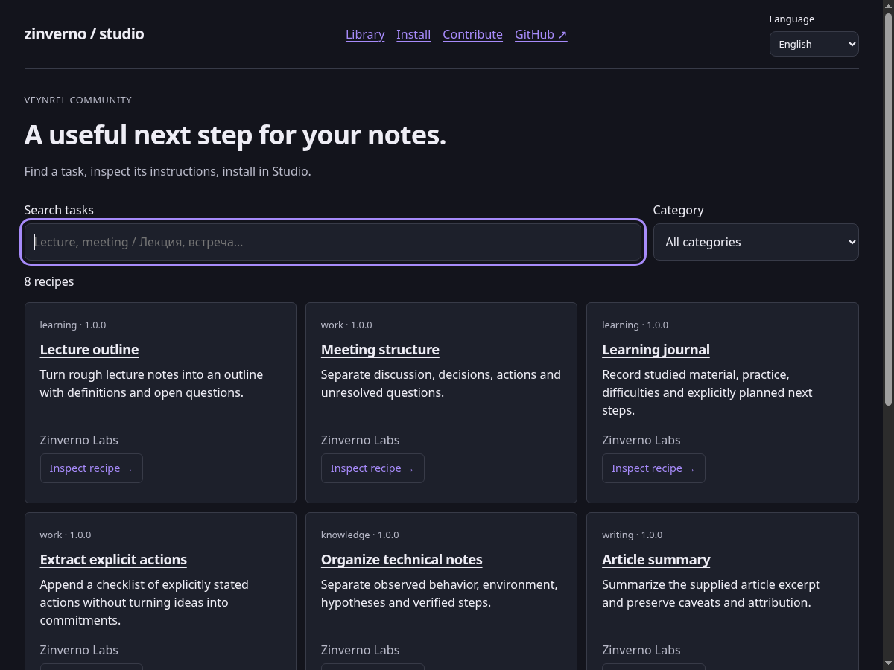
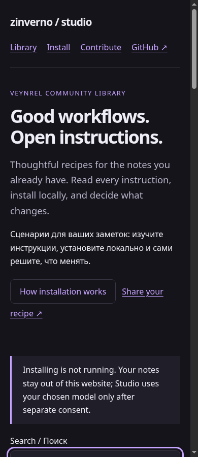
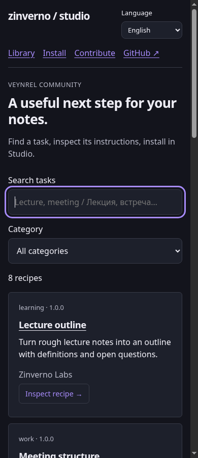
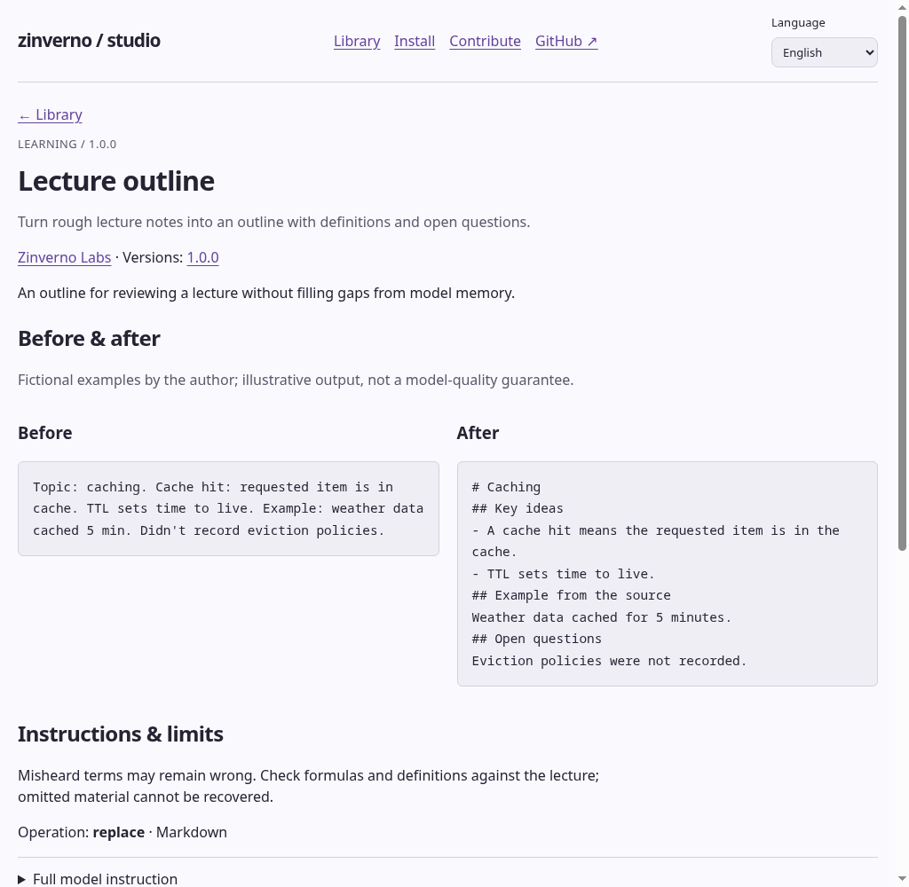

# Local site evidence

All images are full, unmodified Chromium screenshots from the real static builds. Before: main 1832500. After: this branch. Same catalog data, 1200/390 widths and system light/dark emulation. No production deployment.

| Screen | Before | After |
|---|---|---|
| Catalog dark 1200 |  |  |
| Catalog dark 390 |  |  |
| Recipe light 390 |  |  |

The second iteration separates RU/EN on install/contribution pages, localizes category/count labels and verifies no-JavaScript content. browser-report.json records assertions and zero captured errors. Both immutable baselines passed: main 183250019abf26f6f039002ca29b64f43d11bec0 and catalog-published e1de8ec4028c53e32a90d0ec73d5e5c4f40c43f8. Initial sandbox node:test/child-git failures were environmental; the unchanged commands passed on the host.
